# ambientCG: Metal materials

**48 assets from [ambientCG](https://ambientcg.com), dedicated to the public domain under [CC0](https://docs.ambientcg.com/license/).** Use them in any game, free or paid, and change them however you like; no credit is needed.

PBR materials as 1K and 2K JPG maps (colour, normal GL and DX, roughness, AO, displacement), one folder per resolution. 888.8 MB in all.

This is a copy kept by [zuujis-cc0](https://github.com/zuujis-cc0) so game makers can take single files from GitHub. It is not made by or affiliated with ambientCG: the originals, often in more formats and higher resolutions, are on [ambientcg.com](https://ambientcg.com). If they help you, consider [supporting ambientCG](https://www.patreon.com/ambientCG).

Every file is listed in [MANIFEST.tsv](MANIFEST.tsv) with its size and SHA-256. More free assets: [the Zuujis collection](https://github.com/zuujis-cc0/free-game-assets#readme).

| | | | |
| :-: | :-: | :-: | :-: |
| <a href="Metal034">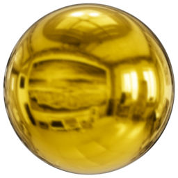</a> <b><a href="Metal034">Metal 034</a></b> by ambientCG · <a href="https://ambientcg.com/a/Metal034">source</a> | <a href="Metal035">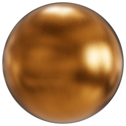</a> <b><a href="Metal035">Metal 035</a></b> by ambientCG · <a href="https://ambientcg.com/a/Metal035">source</a> | <a href="Metal036">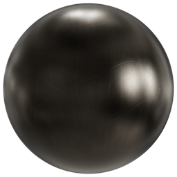</a> <b><a href="Metal036">Metal 036</a></b> by ambientCG · <a href="https://ambientcg.com/a/Metal036">source</a> | <a href="Metal037">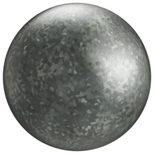</a> <b><a href="Metal037">Metal 037</a></b> by ambientCG · <a href="https://ambientcg.com/a/Metal037">source</a> |
| <a href="Metal038">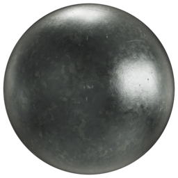</a> <b><a href="Metal038">Metal 038</a></b> by ambientCG · <a href="https://ambientcg.com/a/Metal038">source</a> | <a href="Metal039">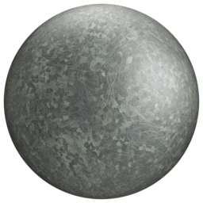</a> <b><a href="Metal039">Metal 039</a></b> by ambientCG · <a href="https://ambientcg.com/a/Metal039">source</a> | <a href="Metal040">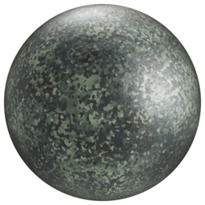</a> <b><a href="Metal040">Metal 040</a></b> by ambientCG · <a href="https://ambientcg.com/a/Metal040">source</a> | <a href="Metal041A">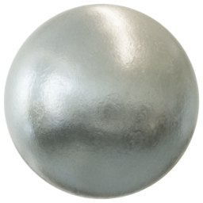</a> <b><a href="Metal041A">Metal 041 A</a></b> by ambientCG · <a href="https://ambientcg.com/a/Metal041A">source</a> |
| <a href="Metal041B">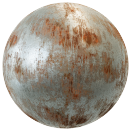</a> <b><a href="Metal041B">Metal 041 B</a></b> by ambientCG · <a href="https://ambientcg.com/a/Metal041B">source</a> | <a href="Metal041C">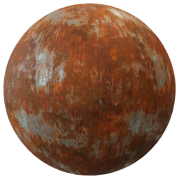</a> <b><a href="Metal041C">Metal 041 C</a></b> by ambientCG · <a href="https://ambientcg.com/a/Metal041C">source</a> | <a href="Metal042A">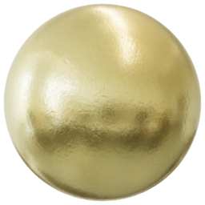</a> <b><a href="Metal042A">Metal 042 A</a></b> by ambientCG · <a href="https://ambientcg.com/a/Metal042A">source</a> | <a href="Metal042B">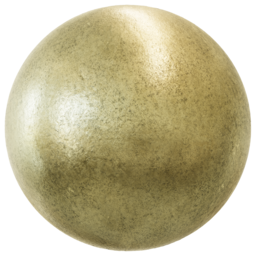</a> <b><a href="Metal042B">Metal 042 B</a></b> by ambientCG · <a href="https://ambientcg.com/a/Metal042B">source</a> |
| <a href="Metal043A">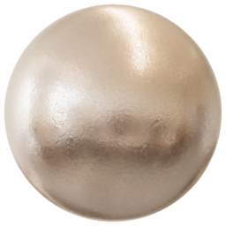</a> <b><a href="Metal043A">Metal 043 A</a></b> by ambientCG · <a href="https://ambientcg.com/a/Metal043A">source</a> | <a href="Metal043B">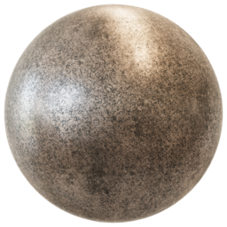</a> <b><a href="Metal043B">Metal 043 B</a></b> by ambientCG · <a href="https://ambientcg.com/a/Metal043B">source</a> | <a href="Metal044A">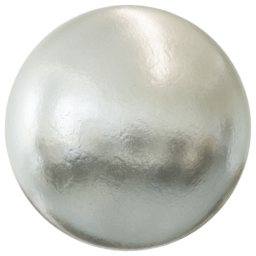</a> <b><a href="Metal044A">Metal 044 A</a></b> by ambientCG · <a href="https://ambientcg.com/a/Metal044A">source</a> | <a href="Metal044B">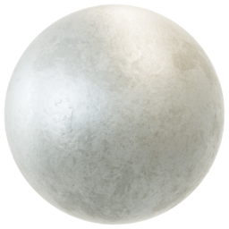</a> <b><a href="Metal044B">Metal 044 B</a></b> by ambientCG · <a href="https://ambientcg.com/a/Metal044B">source</a> |
| <a href="Metal045A">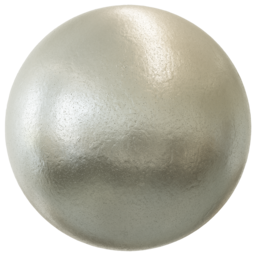</a> <b><a href="Metal045A">Metal 045 A</a></b> by ambientCG · <a href="https://ambientcg.com/a/Metal045A">source</a> | <a href="Metal045B">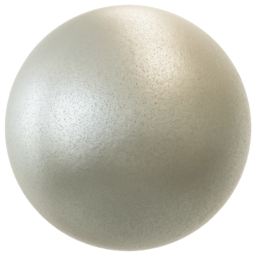</a> <b><a href="Metal045B">Metal 045 B</a></b> by ambientCG · <a href="https://ambientcg.com/a/Metal045B">source</a> | <a href="Metal046A">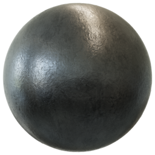</a> <b><a href="Metal046A">Metal 046 A</a></b> by ambientCG · <a href="https://ambientcg.com/a/Metal046A">source</a> | <a href="Metal046B">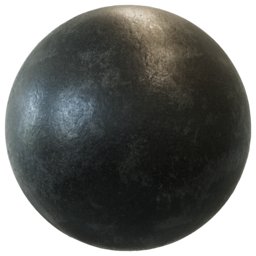</a> <b><a href="Metal046B">Metal 046 B</a></b> by ambientCG · <a href="https://ambientcg.com/a/Metal046B">source</a> |
| <a href="Metal047A">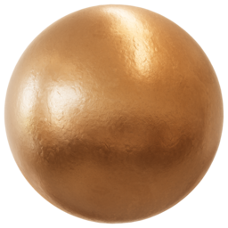</a> <b><a href="Metal047A">Metal 047 A</a></b> by ambientCG · <a href="https://ambientcg.com/a/Metal047A">source</a> | <a href="Metal047B">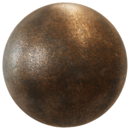</a> <b><a href="Metal047B">Metal 047 B</a></b> by ambientCG · <a href="https://ambientcg.com/a/Metal047B">source</a> | <a href="Metal048A">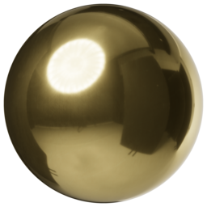</a> <b><a href="Metal048A">Metal 048 A</a></b> by ambientCG · <a href="https://ambientcg.com/a/Metal048A">source</a> | <a href="Metal048B">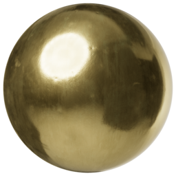</a> <b><a href="Metal048B">Metal 048 B</a></b> by ambientCG · <a href="https://ambientcg.com/a/Metal048B">source</a> |
| <a href="Metal048C">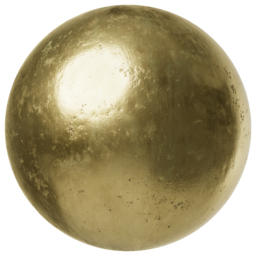</a> <b><a href="Metal048C">Metal 048 C</a></b> by ambientCG · <a href="https://ambientcg.com/a/Metal048C">source</a> | <a href="Metal049A">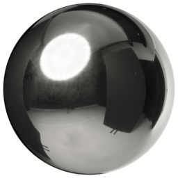</a> <b><a href="Metal049A">Metal 049 A</a></b> by ambientCG · <a href="https://ambientcg.com/a/Metal049A">source</a> | <a href="Metal049B">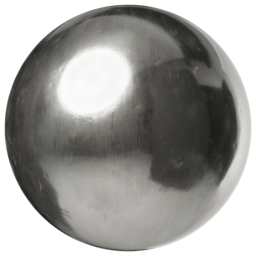</a> <b><a href="Metal049B">Metal 049 B</a></b> by ambientCG · <a href="https://ambientcg.com/a/Metal049B">source</a> | <a href="Metal049C">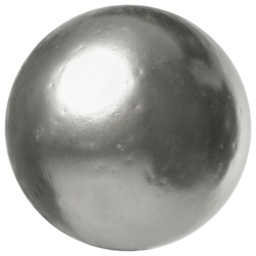</a> <b><a href="Metal049C">Metal 049 C</a></b> by ambientCG · <a href="https://ambientcg.com/a/Metal049C">source</a> |
| <a href="Metal050A">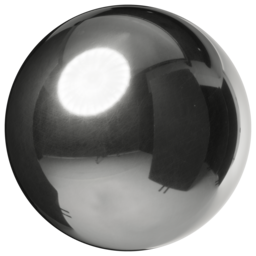</a> <b><a href="Metal050A">Metal 050 A</a></b> by ambientCG · <a href="https://ambientcg.com/a/Metal050A">source</a> | <a href="Metal050B">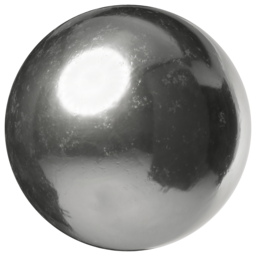</a> <b><a href="Metal050B">Metal 050 B</a></b> by ambientCG · <a href="https://ambientcg.com/a/Metal050B">source</a> | <a href="Metal050C">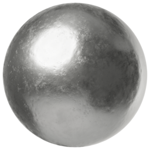</a> <b><a href="Metal050C">Metal 050 C</a></b> by ambientCG · <a href="https://ambientcg.com/a/Metal050C">source</a> | <a href="Metal051A">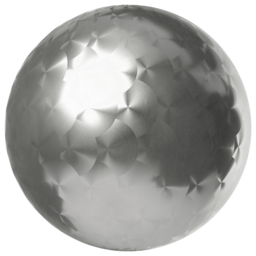</a> <b><a href="Metal051A">Metal 051 A</a></b> by ambientCG · <a href="https://ambientcg.com/a/Metal051A">source</a> |
| <a href="Metal051B">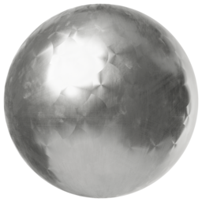</a> <b><a href="Metal051B">Metal 051 B</a></b> by ambientCG · <a href="https://ambientcg.com/a/Metal051B">source</a> | <a href="Metal051C">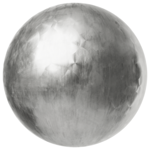</a> <b><a href="Metal051C">Metal 051 C</a></b> by ambientCG · <a href="https://ambientcg.com/a/Metal051C">source</a> | <a href="Metal052A">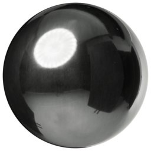</a> <b><a href="Metal052A">Metal 052 A</a></b> by ambientCG · <a href="https://ambientcg.com/a/Metal052A">source</a> | <a href="Metal052B">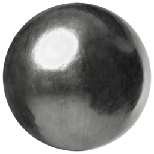</a> <b><a href="Metal052B">Metal 052 B</a></b> by ambientCG · <a href="https://ambientcg.com/a/Metal052B">source</a> |
| <a href="Metal052C">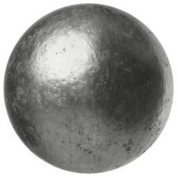</a> <b><a href="Metal052C">Metal 052 C</a></b> by ambientCG · <a href="https://ambientcg.com/a/Metal052C">source</a> | <a href="Metal053A">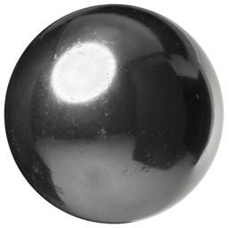</a> <b><a href="Metal053A">Metal 053 A</a></b> by ambientCG · <a href="https://ambientcg.com/a/Metal053A">source</a> | <a href="Metal053B">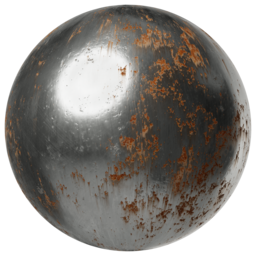</a> <b><a href="Metal053B">Metal 053 B</a></b> by ambientCG · <a href="https://ambientcg.com/a/Metal053B">source</a> | <a href="Metal053C">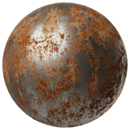</a> <b><a href="Metal053C">Metal 053 C</a></b> by ambientCG · <a href="https://ambientcg.com/a/Metal053C">source</a> |
| <a href="Metal054A">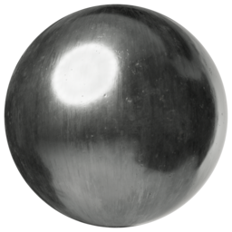</a> <b><a href="Metal054A">Metal 054 A</a></b> by ambientCG · <a href="https://ambientcg.com/a/Metal054A">source</a> | <a href="Metal054B">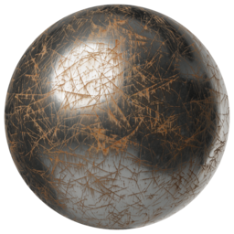</a> <b><a href="Metal054B">Metal 054 B</a></b> by ambientCG · <a href="https://ambientcg.com/a/Metal054B">source</a> | <a href="Metal054C">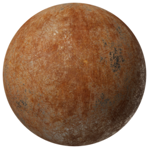</a> <b><a href="Metal054C">Metal 054 C</a></b> by ambientCG · <a href="https://ambientcg.com/a/Metal054C">source</a> | <a href="Metal055A">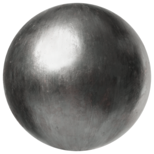</a> <b><a href="Metal055A">Metal 055 A</a></b> by ambientCG · <a href="https://ambientcg.com/a/Metal055A">source</a> |
| <a href="Metal055B">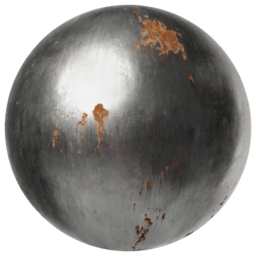</a> <b><a href="Metal055B">Metal 055 B</a></b> by ambientCG · <a href="https://ambientcg.com/a/Metal055B">source</a> | <a href="Metal055C">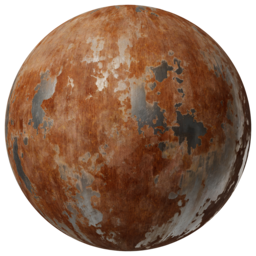</a> <b><a href="Metal055C">Metal 055 C</a></b> by ambientCG · <a href="https://ambientcg.com/a/Metal055C">source</a> | <a href="Metal056A">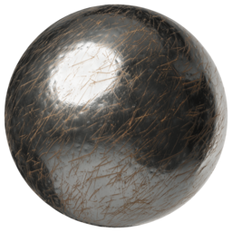</a> <b><a href="Metal056A">Metal 056 A</a></b> by ambientCG · <a href="https://ambientcg.com/a/Metal056A">source</a> | <a href="Metal056B">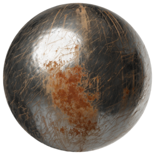</a> <b><a href="Metal056B">Metal 056 B</a></b> by ambientCG · <a href="https://ambientcg.com/a/Metal056B">source</a> |

---

Kept up to date by this repository's own [update workflow](.github/workflows/update.yml), with code and plan from [cc0-mirror](https://github.com/zuujis-cc0/cc0-mirror). Something wrong? [Open an issue there](https://github.com/zuujis-cc0/cc0-mirror/issues/new) or use the [private report form](https://games.zuujis.com/report).
